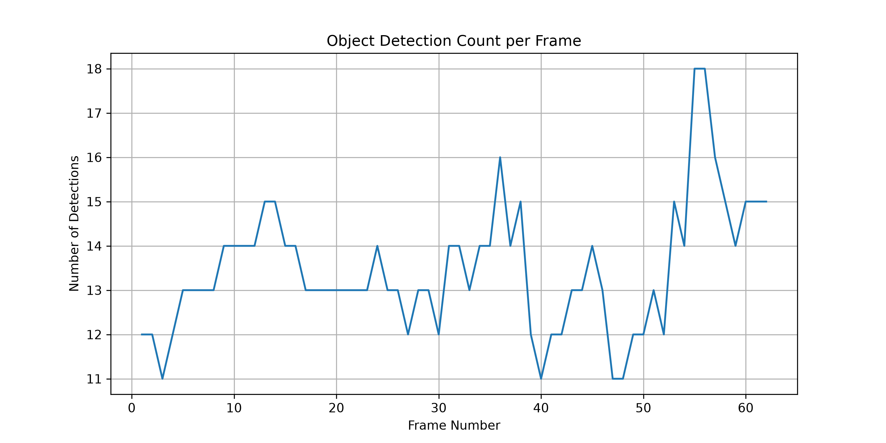
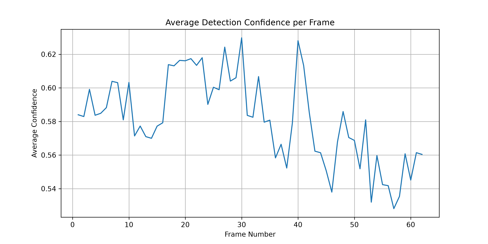
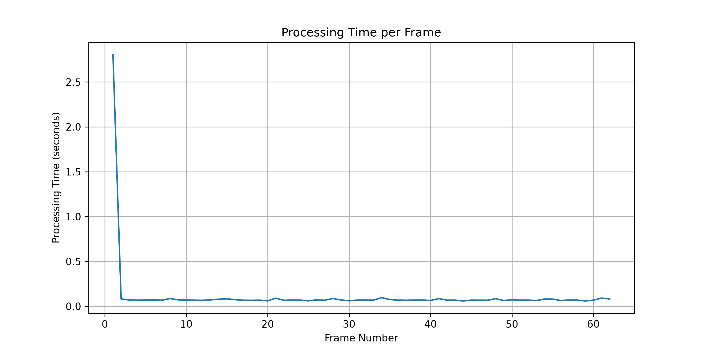

# Real-Time Object Detection and Multi-Object Tracking Using YOLO11 and ByteTrack

## 1. Project Overview

This project implements a computer vision system for object detection and multi-object tracking in videos using YOLO11 Nano and the ByteTrack tracking algorithm.

The system processes video frames, detects objects, assigns unique tracking IDs, and maintains object identities across consecutive frames.

The primary objective is to develop a practical computer vision pipeline that integrates deep learning-based object detection with multi-object tracking for video analysis.

## 2. Project Objectives

- Implement object detection using YOLO11 Nano.
- Integrate ByteTrack for multi-object tracking.
- Assign unique IDs to detected objects.
- Track objects across consecutive video frames.
- Generate annotated output videos.
- Collect frame-level detection and tracking metrics.
- Analyze system performance using data visualization.
- Evaluate processing speed using CPU-based inference.

## 3. Key Features

- YOLO11-based object detection.
- ByteTrack multi-object tracking.
- Unique tracking ID assignment.
- Bounding box visualization.
- Automated video processing.
- Frame-by-frame metrics collection.
- CSV-based performance reports.
- Performance graphs using Matplotlib.
- Configurable detection and tracking settings.
- CPU-based inference.

## 4. Technologies and Libraries

| Technology | Application |
|---|---|
| Python | Main programming language |
| PyTorch | Deep learning framework |
| Ultralytics YOLO11 | Object detection |
| ByteTrack | Multi-object tracking |
| OpenCV | Video processing |
| Pandas | Metrics management |
| NumPy | Numerical operations |
| Matplotlib | Data visualization |
| PyYAML | Configuration management |

## 5. System Architecture

The system follows a sequential computer vision pipeline.

1. **Video Input:** OpenCV reads the input video.
2. **Frame Extraction:** The video is processed frame by frame.
3. **Object Detection:** YOLO11 detects objects in each frame.
4. **Object Tracking:** ByteTrack associates detections across frames.
5. **ID Assignment:** Tracking IDs identify objects across consecutive frames.
6. **Visualization:** Bounding boxes and tracking IDs are drawn on frames.
7. **Metrics Collection:** Detection counts, confidence scores, and processing times are recorded.
8. **Output Generation:** The annotated video, CSV metrics, and performance graphs are saved.

### Workflow Diagram

```text
             Input Video
                  |
                  v
          Video Frame Extraction
                  |
                  v
          YOLO11 Object Detection
                  |
                  v
          ByteTrack Object Tracking
                  |
                  v
          Tracking ID Assignment
                  |
                  v
        Bounding Box Visualization
                  |
                  v
           Metrics Collection
                  |
                  v
        +---------+----------+
        |         |          |
        v         v          v
    Output     CSV Files   Performance
    Video      Metrics      Graphs
```

## 6. Project Structure

```text
YOLO_ByteTrack_Project/
│
├── data/
│   └── videos/
│       └── input.mp4
│
├── src/
│   ├── main.py
│   └── visualize_metrics.py
│
├── models/
│
├── results/
│   ├── videos/
│   │   └── tracked_output.mp4
│   │
│   ├── metrics/
│   │   ├── frame_metrics.csv
│   │   └── summary_metrics.csv
│   │
│   └── plots/
│       ├── detection_count.png
│       ├── average_confidence.png
│       └── processing_time.png
│
├── config.yaml
├── requirements.txt
├── .gitignore
└── README.md
```

## 7. Installation and Setup

### Prerequisites

- Python 3.11 or compatible version.
- pip package manager.
- Git.
- A computer capable of running CPU-based inference.

### Step 1: Clone the Repository

```bash
git clone https://github.com/YOUR_USERNAME/YOLO_ByteTrack_Project.git
cd YOLO_ByteTrack_Project
```

Replace `YOUR_USERNAME` with your GitHub username.

### Step 2: Create a Virtual Environment

```bash
python -m venv venv
```

### Step 3: Activate the Environment

For Windows PowerShell:

```powershell
.\venv\Scripts\Activate.ps1
```

### Step 4: Install Dependencies

```bash
pip install -r requirements.txt
```

## 8. Configuration

The project uses `config.yaml` to manage model, tracking, video, and evaluation settings.

Main configuration parameters:

| Parameter | Value |
|---|---|
| Detection Model | YOLO11 Nano |
| Model Weights | yolo11n.pt |
| Confidence Threshold | 0.35 |
| Image Size | 640 |
| Tracking Algorithm | ByteTrack |
| Inference Device | CPU |
| Input Video | data/videos/input.mp4 |
| Output Video | results/videos/tracked_output.mp4 |

The pretrained YOLO11 Nano weights are downloaded automatically by Ultralytics when required.

## 9. How to Run

### Run Object Detection and Tracking

Execute the following command from the project root:

```bash
python src/main.py
```

The script performs object detection and tracking, generates an annotated video, and saves the collected metrics.

### Generate Performance Graphs

```bash
python src/visualize_metrics.py
```

The script generates performance graphs inside:

```text
results/plots/
```

## 10. Performance Evaluation

The system records frame-level and summary-level performance metrics.

### Collected Metrics

| Metric | Description |
|---|---|
| Total Frames | Number of processed video frames |
| Unique Tracking IDs | Number of distinct tracking IDs observed |
| Average FPS | Average processing speed |
| Average Confidence | Mean detection confidence |
| Detection Count | Number of detections in each frame |
| Processing Time | Time required to process each frame |

### Initial Experimental Results

The initial experiment was conducted using a 62-frame sample video.

| Metric | Result |
|---|---:|
| Total Frames Processed | 62 |
| Unique Tracking IDs | 21 |
| Processing Time | 7.59 seconds |
| Average Processing FPS | 8.17 |
| Average Detection Confidence | 0.5813 |

**Inference Hardware:** CPU-based processing.

These measurements represent an initial experiment using one sample video. They are preliminary system performance results, not formal tracking accuracy measurements.

The 21 unique tracking IDs represent distinct IDs observed throughout the video, not necessarily the number of objects visible simultaneously.

## 11. Performance Visualization

The project generates three performance graphs:
### Detection Count per Frame


### Average Confidence per Frame


### Processing Time per Frame


### 1. Object Detection Count per Frame

Shows how the number of detected objects changes across video frames.

### 2. Average Detection Confidence per Frame

Illustrates the average confidence score of detected objects in each frame.

### 3. Processing Time per Frame

Shows the time required to process individual video frames.

All generated graphs are saved in the `results/plots/` directory.

## 12. Current Limitations

- The current implementation uses CPU-based inference.
- Processing speed depends on available hardware.
- Initial testing uses a relatively small sample video.
- Formal tracking accuracy evaluation using annotated ground-truth datasets has not yet been performed.
- Metrics such as MOTA, IDF1, and HOTA have not yet been calculated.
- Performance has not yet been compared against alternative tracking algorithms.

## 13. Future Improvements

- Evaluate the system using standard multi-object tracking datasets such as MOT17.
- Calculate formal tracking metrics, including MOTA, IDF1, and HOTA.
- Compare different YOLO model sizes.
- Compare ByteTrack with alternative tracking algorithms.
- Improve inference speed and computational efficiency.
- Test the system on longer and more diverse videos.
- Explore GPU acceleration on supported hardware.
- Develop additional evaluation and visualization tools.

## 14. Research Relevance

This project explores important research areas in computer vision:

- Deep learning-based object detection.
- Multi-object tracking.
- Video analysis and understanding.
- Object association across consecutive frames.
- Performance evaluation of computer vision systems.

The implementation provides a practical foundation for further research in intelligent video analysis, automated surveillance, traffic monitoring, and other computer vision applications.

## 15. Author

**Aftab Aleena**

Bachelor of Science in Artificial Intelligence

Nanjing University of Information Science and Technology

## 16. License and Acknowledgements

This project is developed for academic and educational purposes.

The implementation uses the Ultralytics YOLO framework and other open-source Python libraries. Please review the applicable licenses of the frameworks, pretrained models, and datasets before redistribution or commercial use.

Dataset and pretrained model attribution should be maintained according to their respective terms of use.
