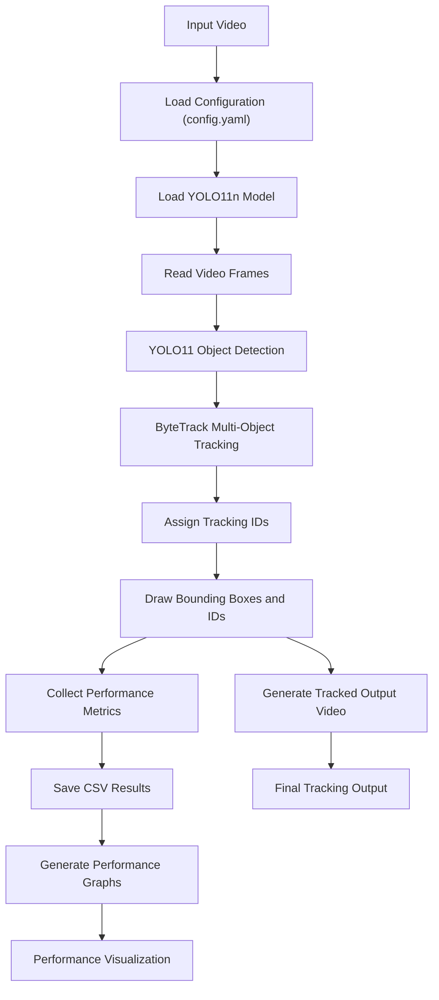

# Project Architecture

## Real-Time Object Detection and Multi-Object Tracking Using YOLO11 and ByteTrack

### System Workflow

### Main Components

1. **Input Video:** Provides the video frames for processing.
2. **Configuration:** Loads model, confidence threshold, tracker, and output settings from `config.yaml`.
3. **YOLO11 Detection:** Detects objects in each video frame.
4. **ByteTrack:** Associates detections across frames and maintains object identities.
5. **Tracking Visualization:** Displays bounding boxes and tracking IDs.
6. **Performance Evaluation:** Records detection counts, tracking counts, confidence scores, and processing time.
7. **Output Generation:** Saves the processed video, CSV metrics, and performance graphs.

### Technologies

- Python 3.11
- YOLO11 (Ultralytics)
- ByteTrack
- OpenCV
- PyTorch
- Pandas
- Matplotlib

### Project Output

The system generates a tracked video, frame-level performance metrics, summary metrics, and visualization graphs.
